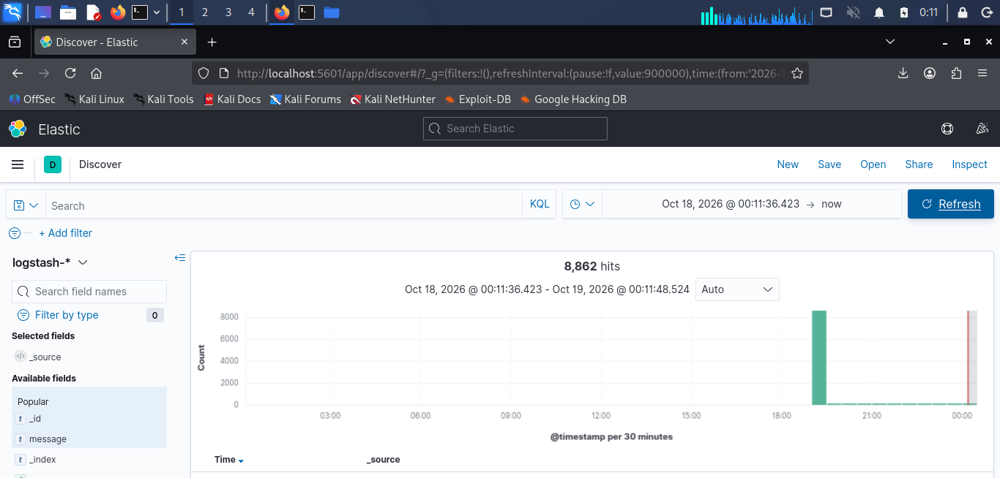
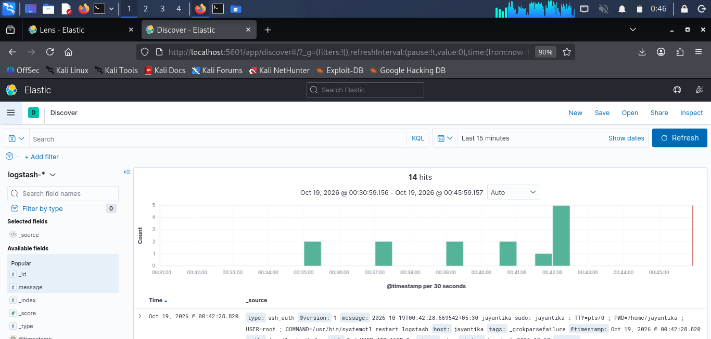
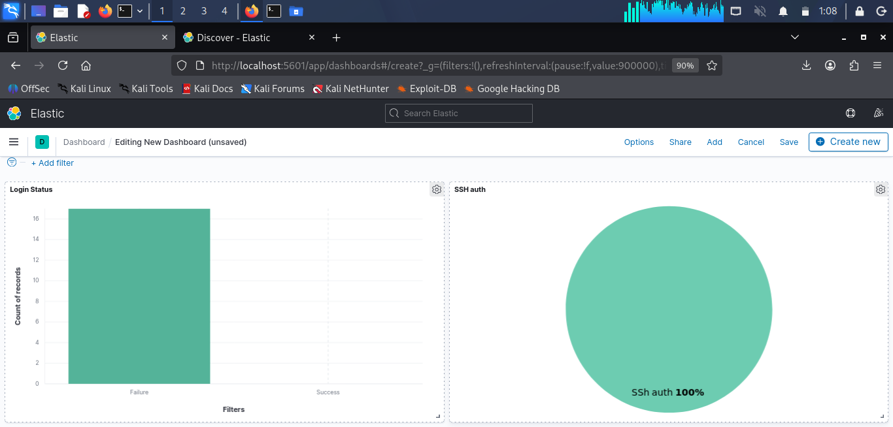

# Kibana Documentation

## 1. Overview

Kibana is the visualization and analysis interface for the project. It connects to Elasticsearch to display web log records, facilitating interactive searches, and present aggregated security information through dashboards.

## 2. Environment

- Operating system: Kali Linux
- Kibana URL: `http://127.0.0.1:5601`
- Data source: `logstash-*`

## 3. Accessing Kibana

To restart Kibana

```bash
sudo systemctl restart kibana
```

Open the following address in a browser on the Kali machine:

http://127.0.0.1:5601

## 4. Observed Results

At the time of the captured dashboard screenshot, the total web request metric displayed 1,619.

The response distribution showed:

- SSH auth: 100% records
- Failure Status: 100% records






## 6. Saved Objects and Export

Kibana supports exporting saved objects, including dashboards, visualizations, searches, and data views.

To export the dashboard:

1. Open Kibana.
2. Navigate to Stack Management => Saved Objects page.
3. Select the dashboard and its related objects.
4. Choose Export.
5. Save the downloaded NDJSON file in the repository's directory.



## 8. Limitations

The dashboard uses real ssh logs rather . The displayed patterns are useful for learning and testing investigative queries but are proof of real attacks.

## 9. Conclusion

Kibana provides the investigation and visualization layer of the Mini SIEM. The dashboard summarizes web activity and supports further analysis of errors, client traffic, and potentially suspicious request patterns.